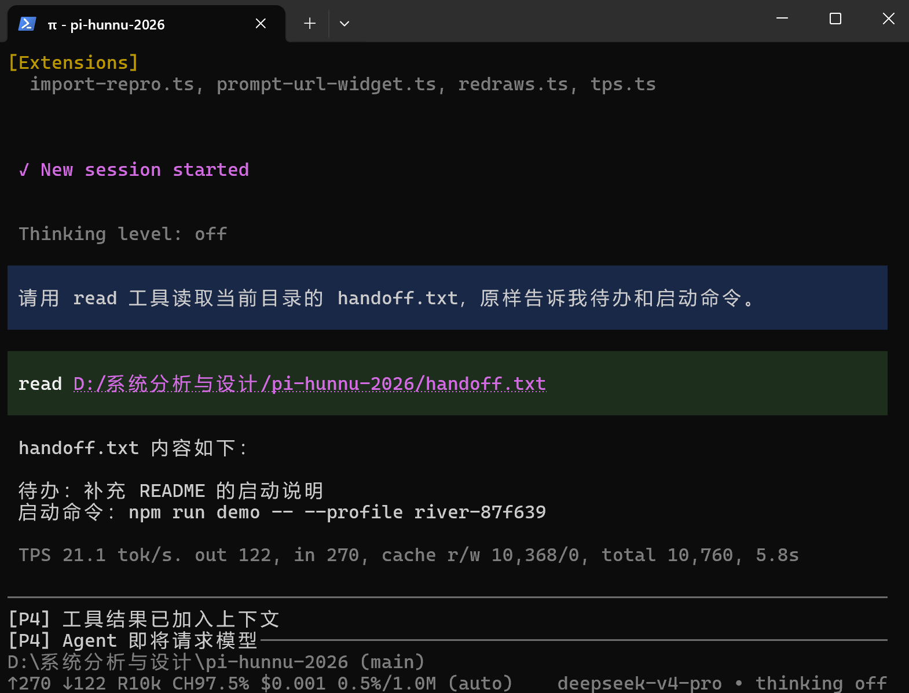
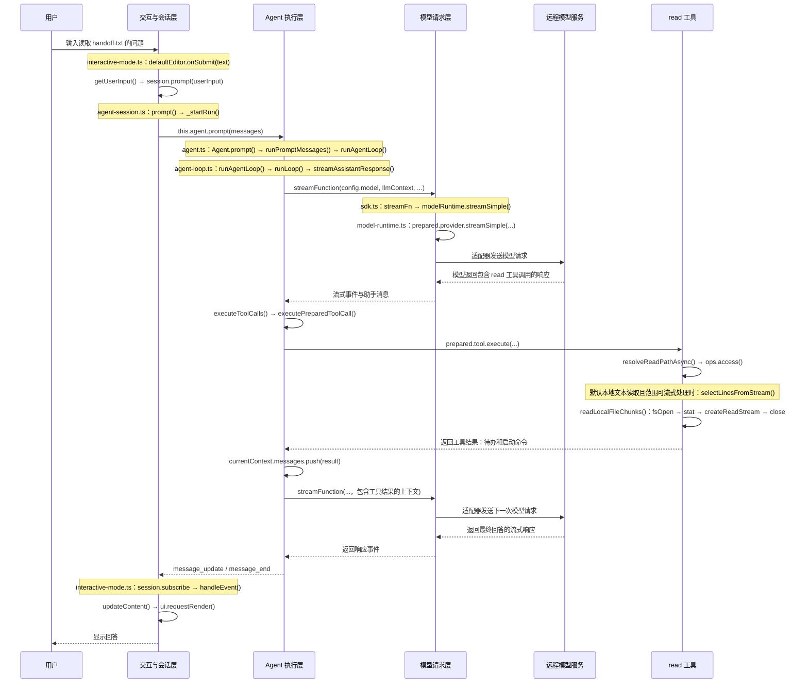
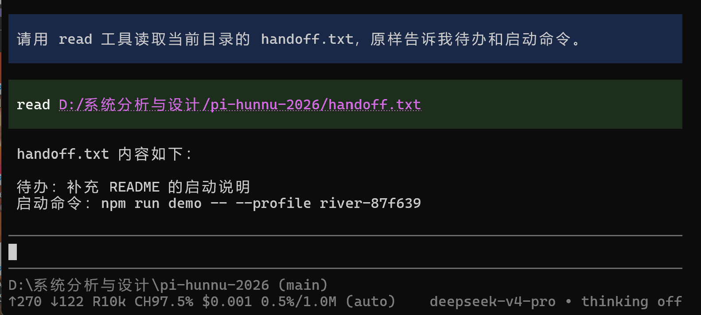
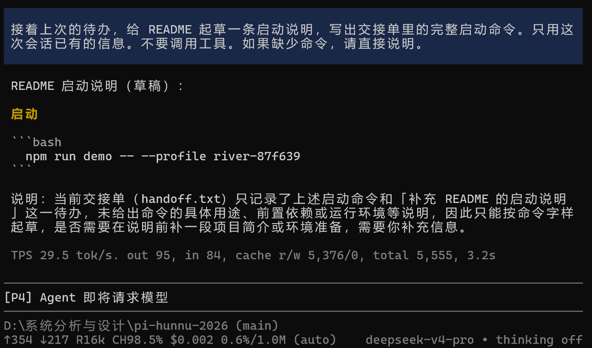
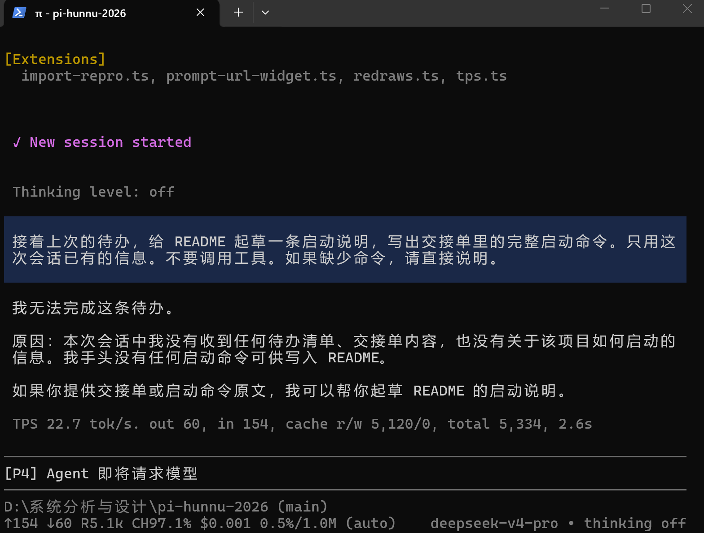
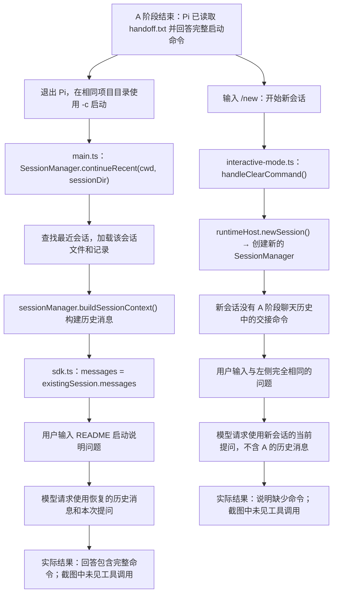

# 实践课 5：Pi Agent 源码泛读与功能定位

姓名：肖璟媛　学号：202430224013

## 实验环境

- 项目：`pi-hunnu-2026`，本地项目根目录为 `D:\系统分析与设计\pi-hunnu-2026`。
- 基础源码版本：`c3cc91632d0a1950fb122605b190233f2aa0006e`。
- Node.js `v24.22.3`，Pi `v1.5.2`；模型 `deepseek-v4-pro`，thinking off。

## 实验 A：一轮工具调用

在项目根目录创建 `handoff.txt`，内容为：

```text
待办：补充 README 的启动说明
启动命令：npm run demo -- --profile river-87f639
```

其中 `river-87f639` 是用于区分实验的随机标识；上面是交接文本，不代表已经执行该命令。新会话中输入的问题没有包含启动命令：

> 请用 read 工具读取当前目录的 handoff.txt，原样告诉我待办和启动命令。

实际观察：界面显示调用了 `read` 读取 `handoff.txt`，随后回复了上述待办和完整命令。截图中可见工具结果加入上下文和随后请求模型的日志。一次用户交互可涉及多次模型请求：模型先产生工具调用，工具结果加入上下文后再请求模型生成回答。



## 图 1：单轮工具调用的代码级时序图

图中的远程模型是额外画出的外部边界，五个主要职责层分别是用户、交互与会话层、Agent 执行层、模型请求层、read 工具。



### 读取方式说明

`read.ts` 的文本分支会检查 `ops.createReadStream && isStreamableRange(offset, limit)`。在默认本地操作且读取范围满足条件时，使用 `selectLinesFromStream()` 和 `readLocalFileChunks()`；不满足条件时转而使用 `ops.readFile()` 和 `selectLinesFromBuffer()`。

## 实验 B：恢复会话与新会话对照

退出 Pi 后，在同一个项目目录执行：

```powershell
node .\packages\coding-agent\dist\cli.js -c
```

界面显示 A 阶段聊天记录被恢复。随后提出以下问题，再通过 `/new` 创建新会话，在同一模型下输入完全相同的问题：

> 接着上次的待办，给 README 起草一条启动说明，写出交接单里的完整启动命令。只用这次会话已有的信息。不要调用工具。如果缺少命令，请直接说明。

| 情况 | 实际回答 | 界面中可见的工具调用 |
| --- | --- | --- |
| `-c` 恢复会话 | 给出 `npm run demo -- --profile river-87f639`，并说明缺少用途和环境等详细信息 | 未见 |
| `/new` 新会话 | 说明本次会话缺少交接单及启动命令，无法给出命令 | 未见 |

恢复历史的界面：



恢复会话后的回答：



新会话的回答：



## 图 2：恢复旧会话和新建会话的对照图

图中从 A 阶段完成读取 `handoff.txt` 开始。实验中先测试恢复会话，再使用 `/new` 测试新会话；两条分支展示的是两种上下文来源的对照，而不是说用户同时打开了两个会话。



### 图 2 实验结果

- A 阶段，Pi 调用 `read` 读取 `handoff.txt`，回答中的完整启动命令为 `npm run demo -- --profile river-87f639`。
- 恢复后，同一模型对后续问题给出了该命令，截图中没有看到重新调用工具。这支持它利用了恢复的会话历史。
- `/new` 后，对完全相同的问题，Pi 回答本次会话缺少交接单和启动命令，截图中没有看到工具调用。

## 总结

本次实验中，Agent 使用 `read` 获取文件内容，并在工具结果进入上下文后生成回答。恢复会话后，后续回答包含此前交接命令；新会话没有 A 阶段的聊天历史，因此在不调用工具的条件下回答缺少命令。
